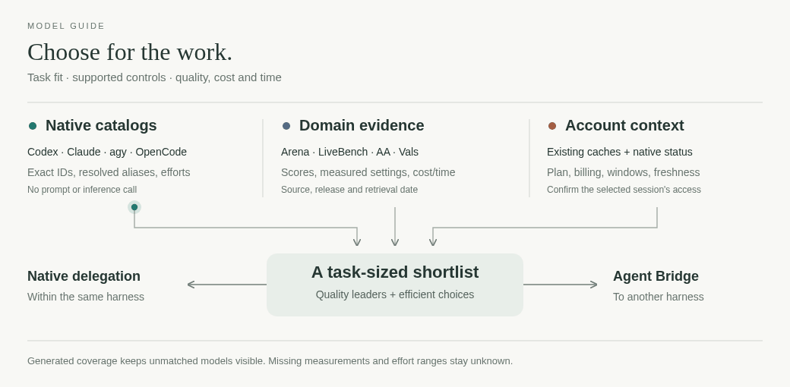

<h1 align="center"></h1>

<p align="center">
<a href="#in-use">In use</a> · <a href="#agent-tools">Agent tools</a> · <a href="#restore">Restore</a> · <a href="#configuration-flow">Configuration flow</a> · <a href="#packages">Packages</a> · <a href="#checks">Checks</a>
</p>

A WSL2 Ubuntu setup with a shared shell, editor and agent tools for Codex, Claude Code,
Antigravity and OpenCode. Review paths, the WSL distro and Windows fonts before restoring.

```sh
git clone https://github.com/vTuanpham/dotfiles-with-agency ~/dotfiles-with-agency && cd ~/dotfiles-with-agency
./install.sh            # preview only: nothing changes
./install.sh --apply    # then apply the steps it listed
```

## In use

**[Wake](claude/README.md#wake-mod-live)** puts the session, its workers and account
quota above the Claude Code prompt.


[Scene, crew and quota legend](claude/README.md#crew-and-quota-rows).


[Eight landscapes, time, weather and session state](claude/README.md#landscapes-and-session-state).

### Shared shell prompt


[Starship configuration and prompt segments](starship/README.md).

## Agent tools


[Bridge](agent-bridge/README.md) delegates across harnesses;
[shared skills](agents/README.md) route model choice, native delegation and verification.

### Model selection



`model-guide benchmarks --backend codex --domain backend --limit 3 --brief`
shows quality leaders and efficient alternatives.
[Native controls, domain evidence and account context](agent-models/README.md).

### Questions on your PC or phone


Phone pushes and session-isolated replies. [Setup](agent-baton/README.md#phone-alerts-and-remote-handoff)
· [Questions and private handoffs](agent-baton/README.md#unanswered-questions).

### Your sessions on your phone


[Agent Inbox: pairing, live chat and native controls](agent-inbox/README.md#connect-a-harness).

### Local previews, anywhere


[Portlink](portlink/README.md): private, expiring links to an app, build folder or file.

Behind the scenes: [resource admission](agent-resources/README.md),
[account observations](agent-accounts/README.md), [persistent labs](agent-lab/README.md)
and [Codex notifications](codex-wake/README.md).

## Restore

```sh
./install.sh                 # preview missing tools, links and config differences
./install.sh --apply         # apply the listed steps
./install.sh --apply links   # or choose specific steps
```

Existing files that differ are preserved; hook/plugin merges retain live settings and leave a backup.

Still manual:

- Node via nvm, `rtk`, `agy`, harness logins and `sudo tailscale up`.
- The private secrets file, described below.
- [Chrome extension registration](chrome/README.md) and [Windows terminal setup](windows/README.md).
- The external plugins and preview tools listed in [shell](shell/README.md),
  [Neovim](nvim/README.md) and [Ranger](ranger/README.md), before using those configs.

Credentials and machine-local state stay outside Git.
[Private credentials and permissions](shell/README.md#credentials).

## Configuration flow


Snapshots never flow back automatically; generated changes stay uncommitted.
[Handling and publication rules](AGENTS.md) · [Public-data checks](tests/README.md).

## Packages

One folder per package; paths mirror `$HOME`. Each README states its install flow.

| Package | Kind | Contents |
| --- | --- | --- |
| [shell](shell/README.md) | Live | Bash/Zsh startup, environment, aliases, CUDA and private credential include |
| [starship](starship/README.md) | Live | Shared prompt |
| [agents](agents/README.md) | Live | Shared instructions and engineering skills |
| [git](git/README.md), [npm](npm/README.md) | Snapshot | Git preferences, global ignore and npm prefix |
| [nvim](nvim/README.md) | Snapshot | LazyVim config, plugin lock and Ghost/WSL image support |
| [ranger](ranger/README.md) | Snapshot | Inline previews, Windows media opener and file icons |
| [ghostty](ghostty/README.md) | Snapshot, copy by hand | Zsh terminal integration; not in `install.sh` |
| [rtk](rtk/README.md) | Snapshot | Tool preferences |
| [desktop](desktop/README.md) | Snapshot | Linux MIME application preferences |
| [claude](claude/README.md), [codex](codex/README.md) | Snapshot + live | Harness preferences, native account CLIs (`cswap`, `codex-auth`), hooks, skills and Wake |
| [opencode](opencode/README.md) | Snapshot + live | Interface preferences, shared instructions and the native process guard |
| [gemini](gemini/README.md) | Live + merged hooks | Antigravity instructions, skills and native hooks |
| [agent-bridge](agent-bridge/README.md), [agent-baton](agent-baton/README.md) | uv tool | Cross-harness jobs and human handoff CLIs; editable uv tools |
| [agent-inbox](agent-inbox/README.md) | uv tool + user service | Phone chat for existing root conversations; editable uv tool |
| [portlink](portlink/README.md) | uv tool | Private preview URLs, QR codes and automatic route expiry |
| [codex-wake](codex-wake/README.md) | uv tool | Native Codex task notifications from commands, hooks and event producers |
| [agent-models](agent-models/README.md) | uv tool + timer | General model references and source-reviewed refresh |
| [agent-resources](agent-resources/README.md) | uv tool | Cooperative host resource queue |
| [agent-accounts](agent-accounts/README.md) | uv tool | Independent cached account observations |
| [agent-lab](agent-lab/README.md) | uv tool + live skill and timer | Persistent experiment folders, provenance and retirement cleanup |
| [systemd](systemd/README.md) | Live + reference | User units, reference timer and service PATH |
| [chrome](chrome/README.md) | Live + manual | Global Chrome extensions; ChatGPT browser transport from WSL |
| [github](github/README.md) | Live + manual | Native GitHub tools using the GitHub CLI credential store |
| [windows](windows/README.md) | Manual | GhostInTheWSL and Windows Terminal configs; copy separately |
| [tests](tests/README.md) | n/a | Installer, shell and public-facing checks |

## What starts on its own

[Timers, catalog refresh, lab cleanup and startup tasks](systemd/README.md#startup-and-timers)
· [Codex reset tracker](https://github.com/vTuanpham/codex-reset-tracker).

## Checks

From the repository root:

```sh
python3 -B tests/check_public.py
python3 -B tests/test_public.py
python3 -B tests/test_install.py
python3 -B tests/test_shell_startup.py
```

[Test scope](tests/README.md); package READMEs list their own checks.
[Ponytail](https://github.com/DietrichGebert/ponytail) is enabled in the Claude/Codex snapshots;
its setup and hook trust live in those harness READMEs.

## License

Original files: [MIT](LICENSE). Third-party parts keep their own licenses:
Ghostty's Zsh integration (`ghostty/`, GPL-3.0), ranger-devicons (`ranger/`, with the
Nerd Fonts notice), and the LazyVim starter (`nvim/.config/nvim/LICENSE`, Apache-2.0).
[Harness marks](agent-inbox/src/agent_inbox/assets/NOTICE.md) keep their owners' terms.
