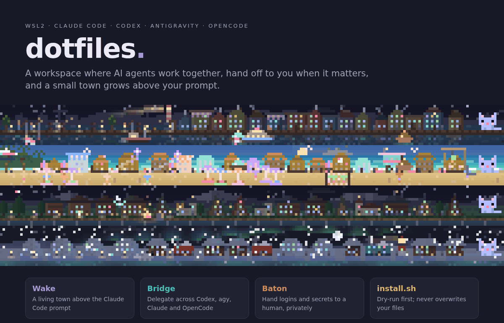
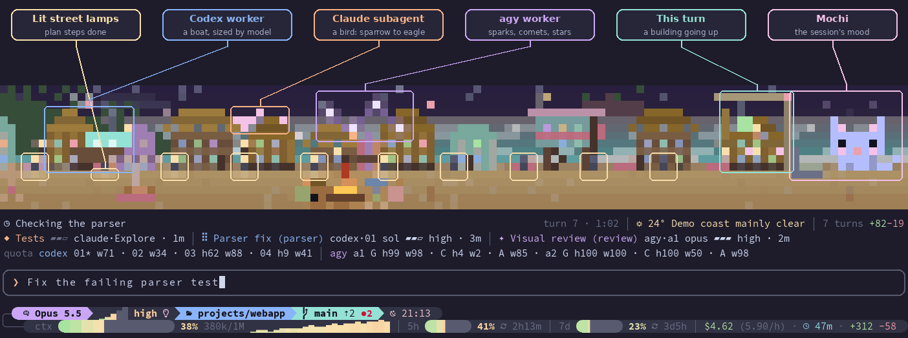
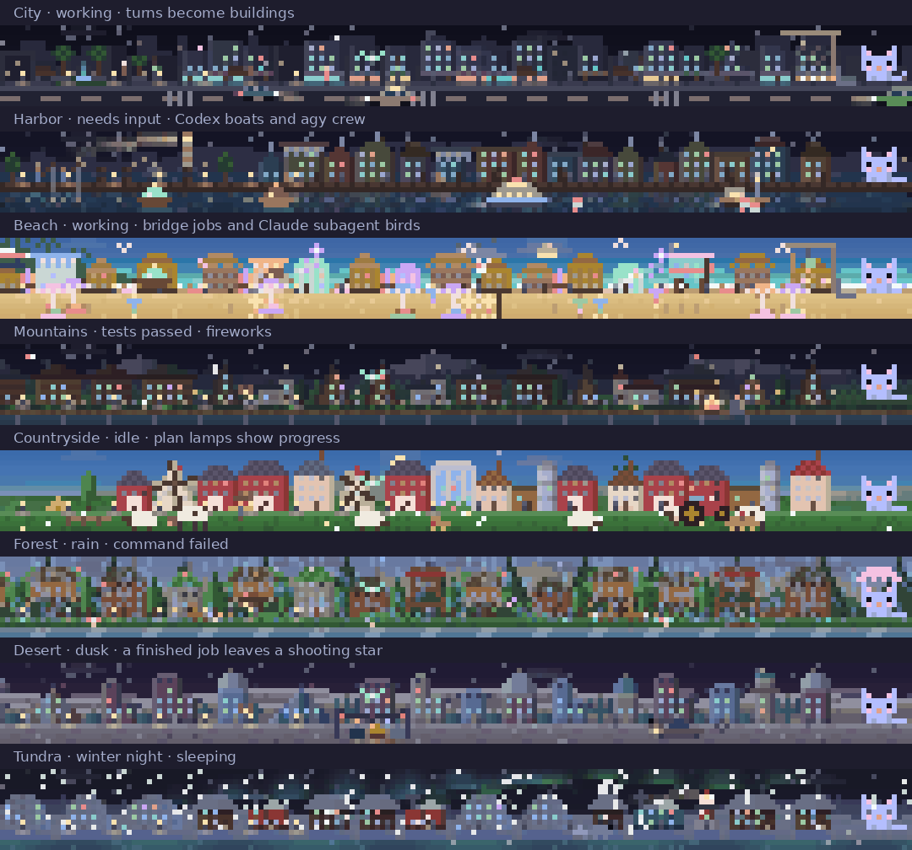
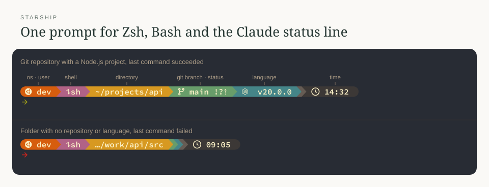
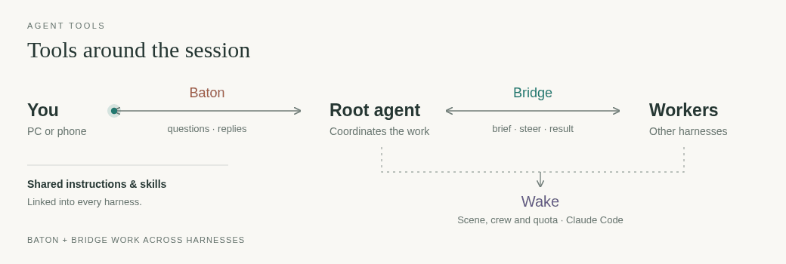
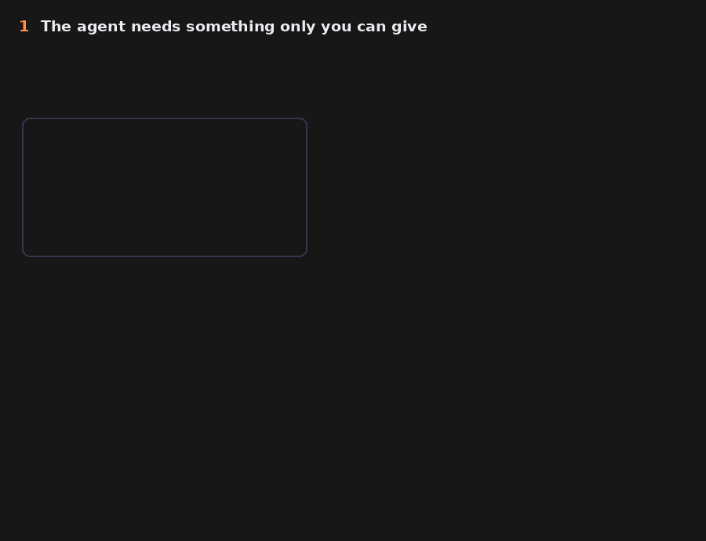
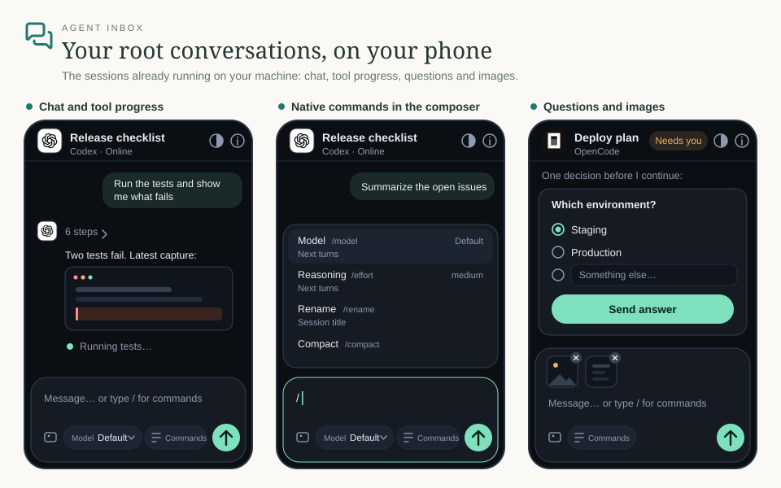
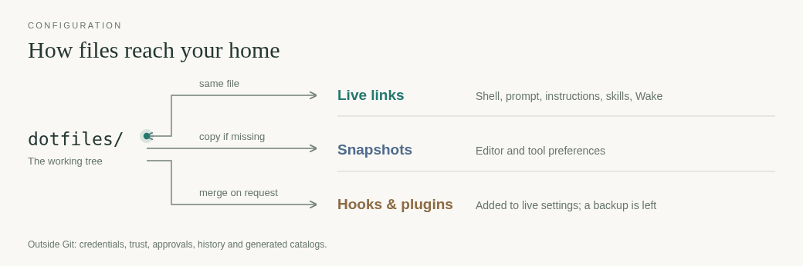

<h1 align="center"></h1>

<p align="center">
<a href="#in-use">In use</a> · <a href="#agent-tools">Agent tools</a> · <a href="#restore">Restore</a> · <a href="#configuration-flow">Configuration flow</a> · <a href="#packages">Packages</a> · <a href="#checks">Checks</a>
</p>

A WSL2 Ubuntu setup: Bash/Zsh, terminals, Neovim, and shared tooling for Claude Code,
Codex, Antigravity and OpenCode. Published as a reference; review paths, the WSL distro
and Windows fonts before restoring it.

```sh
git clone https://github.com/vTuanpham/dotfiles ~/dotfiles && cd ~/dotfiles
./install.sh            # preview only: nothing changes
./install.sh --apply    # then apply the steps it listed
```

## In use

**[Wake](claude/README.md#wake-mod-live)** puts the session, its workers and account
quota above the Claude Code prompt.



Call-outs name what each thing is, and follow it as it moves. Below the scene are the
activity, crew and quota rows, then the prompt and the Claude Code status line (model and
effort, folder and branch, context, 5-hour and 7-day limits, cost). `h` is five-hour, `w`
weekly, `*` the active account. All account identifiers and quota values in these
illustrations are synthetic, not a subscription inventory. agy's `G`, `C`, `A`
are Gemini, Claude/GPT and Argon.
[Crew and quota details](claude/README.md#crew-and-quota-rows).

Eight landscapes, with time, weather and session state drawn into the scene: work, a
question for you, passed tests (fireworks), a failed command (storm), a finished job
(shooting star), sleep. `/wake tour` visits them all; `/wake scene <name>` pins one.



[Scene behavior and commands](claude/README.md#landscapes-and-session-state).

### Shared shell prompt



[Starship configuration and prompt segments](starship/README.md).

## Agent tools



- **[Agent Bridge](agent-bridge/README.md)**: persistent jobs, live steering, resource limits.
- **[Agent Baton](agent-baton/README.md)**: questions, choices and private secret handoffs.
- **[Agent Inbox](agent-inbox/README.md)**: your existing root conversations, chat and questions, on your phone.
- **[Codex Wake](codex-wake/README.md)**: native session wake-ups from background commands and task events.
- **[Agent Lab](agent-lab/README.md)**: persistent experiments, provenance, size warnings and safe retirement.
- **[Wake](claude/README.md#wake-mod-live)**: the Claude-only landscape, crew and quota rows shown above.
- **[Shared instructions](agents/README.md)**: one `AGENTS.md` plus the Bridge and Baton briefings.

The CLIs document their workflows through `agent-bridge guide workflow` and
`agent-baton --help`; exact permission grants stay local.
[Claude](claude/README.md#hooks) and [Codex](codex/README.md) document the shared
RTK/Baton hooks and their trust setup. Antigravity and OpenCode have no hooks
configured here.

### Questions on your PC or phone



The real toast and page, with an example site and fake values. Baton also sends an
urgent phone push; the same form opens over Tailscale. Replies return to their
originating session. [Phone setup](agent-baton/README.md#phone-alerts-and-remote-handoff)
· [Question types and reminders](agent-baton/README.md#unanswered-questions).

### Your sessions on your phone



[Agent Inbox](agent-inbox/README.md) shows the root conversations already running on your
machine. [Connections, pairing and delivery](agent-inbox/README.md#connect-a-harness).

### Plugin: ponytail

[Ponytail](https://github.com/DietrichGebert/ponytail) asks agents to use the smallest
complete solution. The Claude and Codex snapshots enable it; its own plugin hooks
supply the session banner. Use `/ponytail lite|full|ultra` or say "stop ponytail".
See each harness's README for installation and hook trust.

## Restore

```sh
./install.sh                 # preview missing tools, links and config differences
./install.sh --apply         # apply the listed steps
./install.sh --apply links   # or choose specific steps
```

The installer adds apt tools, standalone installers, editable uv tools, npm globals,
live links, missing snapshots, hooks and scheduled jobs. Existing config files that
differ are left alone; hook/plugin merges keep the live content and leave a backup.

Still manual:

- Node via nvm, `rtk`, `agy`, harness logins and `sudo tailscale up`.
- The private secrets file, described below.
- [Chrome extension registration](chrome/README.md) and [Windows terminal setup](windows/README.md).
- The external plugins and preview tools listed in [shell](shell/README.md),
  [Neovim](nvim/README.md) and [Ranger](ranger/README.md), before using those configs.

Credentials belong in `~/.config/shell/secrets.local.sh`, provisioned separately
with mode `0600` inside a `0700` directory. Authentication stores, browser profiles,
history and private backups stay outside this repository. See
[shell setup](shell/README.md#credentials) for the include and backup details.

## Configuration flow



Live links are the same files as the working tree; snapshots never
flow back automatically. Generated changes stay uncommitted; publishing still takes
an explicit commit and push. [AGENTS.md](AGENTS.md) gives the handling rules for each
kind of file.

Before staging, inspect the diff and run `python3 -B tests/check_public.py --changed`.
The pre-commit hook checks staged content for known secrets, personal identifiers
and machine-local state. Keep private names in the local
`~/.config/dotfiles/private-terms.txt`; review images and unfamiliar personal details
by hand. Stage explicit paths. Enable the hook with `./install.sh --apply githooks`.

## Packages

One folder per package, with paths that mirror `$HOME` (Stow-style; `install.sh`
does the linking). Every package README opens with its kind.

| Package | Kind | Contents |
| --- | --- | --- |
| [shell](shell/README.md) | Live | Bash/Zsh startup, environment, aliases, CUDA and private credential include |
| [starship](starship/README.md) | Live | Shared prompt |
| [agents](agents/README.md) | Live | Shared instructions, Bridge/Baton and nine pstack engineering skills |
| [git](git/README.md), [npm](npm/README.md) | Snapshot | Git preferences, global ignore and npm prefix |
| [nvim](nvim/README.md) | Snapshot | LazyVim config, plugin lock and Ghost/WSL image support |
| [ranger](ranger/README.md) | Snapshot | Inline previews, Windows media opener and file icons |
| [ghostty](ghostty/README.md) | Snapshot, copy by hand | Zsh terminal integration; not in `install.sh` |
| [rtk](rtk/README.md) | Snapshot | Tool preferences |
| [desktop](desktop/README.md) | Snapshot | Linux MIME application preferences |
| [claude](claude/README.md), [codex](codex/README.md) | Snapshot + live | Harness preferences, hooks, skills and, for Claude, Wake |
| [opencode](opencode/README.md) | Snapshot + live | Interface preferences and the shared-instructions link |
| [gemini](gemini/README.md) | Live | Antigravity links to the shared instructions and skills |
| [agent-bridge](agent-bridge/README.md), [agent-baton](agent-baton/README.md) | uv tool | Cross-harness jobs and human handoff CLIs; editable uv tools |
| [agent-inbox](agent-inbox/README.md) | uv tool + user service | Phone chat for existing root conversations; editable uv tool |
| [portlink](portlink/README.md) | uv tool | Private preview URLs, QR codes and automatic route expiry |
| [codex-wake](codex-wake/README.md) | uv tool | Native Codex task notifications from commands, hooks and event producers |
| [agent-lab](agent-lab/README.md) | uv tool + live skill and timer | Persistent experiment folders, provenance and retirement cleanup |
| [systemd](systemd/README.md) | Live + reference | User units, reference timer and service PATH |
| [chrome](chrome/README.md) | Live + manual | Global Chrome extensions; ChatGPT browser transport from WSL |
| [github](github/README.md) | Live + manual | Native GitHub tools using the GitHub CLI credential store |
| [windows](windows/README.md) | Manual | GhostInTheWSL and Windows Terminal configs; copy separately |
| [tests](tests/README.md) | n/a | Installer, shell and public-facing checks |

## What starts on its own

The reference timer, catalog cron job and the
[reset tracker](https://github.com/vTuanpham/codex-reset-tracker) service already
have their own owners; no extra startup script is needed. The installer enables the
reference and retired-lab cleanup timers and adds the catalog cron line. Tracker setup, Tailscale forwards
and hidden Windows startup tasks are described in
[systemd](systemd/README.md#startup-and-timers).

## Checks

From the repository root:

```sh
python3 -B tests/check_public.py
python3 -B tests/test_public.py
python3 -B tests/test_install.py
python3 -B tests/test_shell_startup.py
```

The installer checks use a throwaway home. See [tests](tests/README.md) for scope,
[Ranger](ranger/README.md) for its media check, and the tool READMEs for their
`uv run pytest` suites. Restore only the steps you need, keep private backups
outside the checkout, and resolve conflicts deliberately: `install.sh` never
overwrites a file that differs.

## License

Original files: [MIT](LICENSE). Third-party parts keep their own licenses:
Ghostty's Zsh integration (`ghostty/`, GPL-3.0), ranger-devicons (`ranger/`, with the
Nerd Fonts notice), and the LazyVim starter (`nvim/.config/nvim/LICENSE`, Apache-2.0).
[Harness marks](agent-inbox/src/agent_inbox/assets/NOTICE.md) keep their owners' terms.
