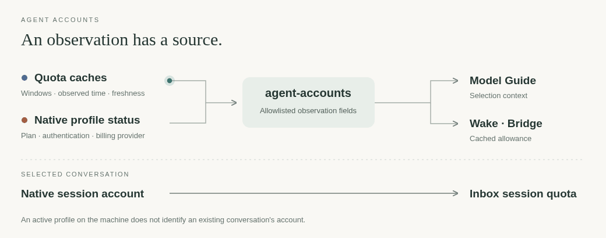

# agent-accounts

[← Packages](../README.md#packages) · **uv tool** · account observations



Read account inventory without scanning jobs, messages or peer history.
The JSON contract carries account aliases, provider, windows, observation time
and freshness. Codex's local cache has unknown freshness; agy's cache becomes
stale after ten minutes. Addresses are omitted from this shared inventory.

```sh
uv tool install --editable ./agent-accounts
agent-accounts snapshot
agent-accounts refresh --account a1   # explicit agy allowance refresh
agent-accounts refresh --backend claude # explicit cswap allowance refresh
```

Snapshot reads local Codex data through `codex-auth list --skip-api`,
`~/.agy-accounts/*/quota.json`, and the last explicit Claude refresh under
`${XDG_STATE_HOME:-$HOME/.local/state}/agent-accounts/claude.json`.
Claude refresh calls `cswap list --json`; it can query usage and renew credentials,
so background snapshots never invoke it. The cache keeps only numbered allowance
fields, excludes addresses and aliases, and expires freshness after ten minutes.
Claude's percentages are used allowance; this boundary converts them to remaining,
rounds down and never treats unavailable, elapsed or missing windows as free quota.
The active mark records the account at the last refresh; it is not session identity.
Native account selection stays in [cswap](../claude/README.md#accounts).

Model-guide searches also use the provider context helper: quota observations
plus Claude's native auth-status plan/billing profile, with identity fields
removed. These hints are read dynamically, not stored in the benchmark snapshot
or hardcoded as model entitlements. Existing sessions can retain a different
account from the current profile.

Refresh uses the selected account's existing file login and validates the result
before atomically replacing its private quota cache. It never signs in, switches
accounts or creates an auth store. Refresh without --account queries all existing
signed-in agy accounts. Claude refresh reads the full managed inventory and does
not accept `--account`. Errors do not include provider stderr or credential data.

Inbox continues to read allowance from the selected native daemon; a machine-wide
cache must not substitute for a conversation's account. This matches
[T3 Code's instance/account isolation](https://github.com/pingdotgg/t3code/blob/main/docs/internals/providers.md).

Checks: `uv run pytest` and `uv run ruff check src tests`.
