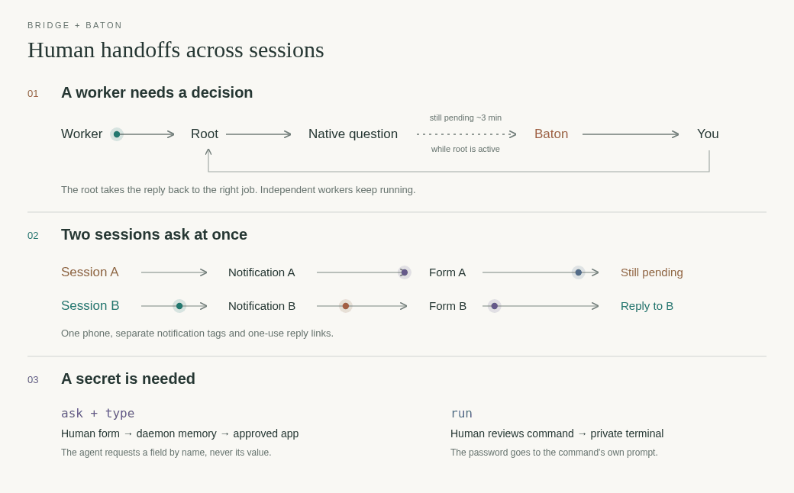
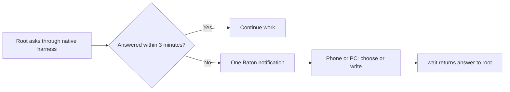
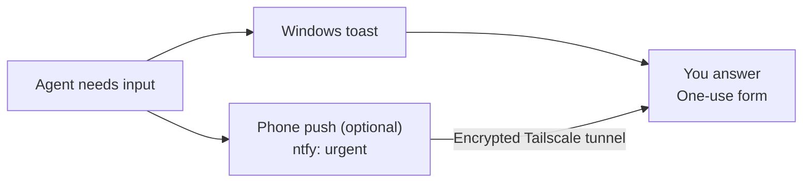

# agent-baton

[← Packages](../README.md#packages) · **uv tool** (editable) · [Commands](#commands) · [Workflow](#workflow-overview) · [Questions](#unanswered-questions) · [Sessions](#simultaneous-sessions) · [Native questions](#native-questions-and-hooks) · [Phone](#phone-alerts-and-remote-handoff)

A cross-harness CLI for human handoffs: ordinary questions return readable answers;
login, code and password forms keep secrets hidden from the agent. A one-use page
opens from a Windows notification or phone alert. State lives in `~/.local/state/agent-baton`.


*The real toast and page, with an example site and fake values; regenerate with `docs/tools/baton_gif.py`.*

```sh
uv tool install --editable ~/dotfiles/agent-baton
agent-baton --help             # the workflow; agents read it when they need it
agent-baton doctor             # checks the toast, typing, hooks and the phone path, and says what to fix
```

## Commands

For native tools, register `codex mcp add agent_baton -- agent-baton mcp`, then
reload MCP configuration. Other harnesses can launch the same stdio command.
Every call supplies the conversation owner: `codex:<CODEX_THREAD_ID>`,
`claude:<CLAUDE_CODE_SESSION_ID>` or `explicit:<unique id>`, even when several
conversations share a server. CLI and MCP select the same requests.

| Native tool | Purpose |
| --- | --- |
| `question` | Free text, single choice or select-many; ordinary answers only |
| `ask`, `env_secret` | Human enters secrets; `env_secret` writes to environment files without returning the value |
| `status`, `wait` | Session state or answers; secret readiness without values |
| `focus`, `type_answer` | Activate approved window, then type a held field by name |
| `forget`, `withdraw` | Erase held answers or withdraw an obsolete question |

Results contain `exit_code` and the existing CLI's `output`; exit 75 means pending.
`wait` checks immediately by default; intentional waits are bounded to 30 seconds.
For longer event waits, run CLI `wait --until-done` in the background.
CLI still owns composite forms, command approval and human-only login handoffs.
MCP adds no HTTP listener or global conversation state.

- `question "Which scope?" --option "Current project" --option "All projects"`
  collects one ordinary answer. Omit options for free text; choices include Other.
  `wait <id> --until-done`, run in the background, ends when the human answers or the request
  expires and returns JSON with `id`, `question`, and `answer`. A foreground call uses
  `--timeout 60` instead (exit 75 = still held).
- `ask` builds a secret form (`name[:secret]=Label`); the human answers on a Windows toast link or, over Tailscale, on
  a phone (ntfy). `type <name>` then puts the held answer into the approved window at the OS level, through
  X11 for WSLg windows or PowerShell for Windows ones, and refuses terminals and agent windows.
  Use `focus --id <id>` before selecting the field: extension actions can target background tabs,
  while desktop typing needs the intended tab selected. Windows typing preserves field focus and
  refuses a background window, missing payload, or rejected keyboard input.
- `env LIQUID_API_KEY --prefix liquid_ --file ~/.config/shell/secrets.local.sh --file .env --reason "Configure the API client"`
  asks the human for a masked value and stores it directly in those files. Shell files use `export`, other files use
  plain `NAME=value`; matching entries are replaced. Existing files are backed up with restore paths under
  `$XDG_STATE_HOME/backups/env-secrets/`, and targets end with mode `0600`. Symlinked and group/world-writable
  targets are refused. `wait <id>` reports only the name, paths and backup location.
- `run -- <command>` lets the human approve the exact command and type a password on a page (sudo, ssh, gpg).
- `pass <site>` is for steps only a human can do (CAPTCHA, passkey): browser and screen tools stay blocked
  until they hand it back.
- `agent-baton guard` is the `PreToolUse` hook that does the blocking; `install.sh --apply hooks` adds it to
  the Claude and Codex configs.

## Workflow overview



With [Agent Bridge](../agent-bridge/README.md#when-a-worker-needs-you), the root
connects worker state to the human handoff, then steers or resumes the right job.
The picture shows the root's coordination steps; it does not imply an automatic relay.
The sections below give each path's rules.

## Unanswered questions

| Question type | CLI | Returned `answer` |
| --- | --- | --- |
| Free text, including multiline | `question "What should change?"` | String |
| Yes/no or explicit approval | `question "Proceed?" --option "Yes, proceed" --option "No"` | String |
| Single choice | `question "Scope?" --option "Local" --option "Shared"` | String |
| Select all that apply | `question "Platforms?" --multiple --option "Linux" --option "Windows"` | List of strings |

Choice forms include Other with a written answer. Select-many results follow the
listed option order, then Other if provided. Nothing is preselected. Each call
collects one question; mandatory harness permission dialogs still apply.

For several questions or a one-off UI, agents can use the CLI JSON interface:

```sh
agent-baton form examples/review-form.json
agent-baton wait <id> --timeout 60
```

The [example definition](examples/review-form.json) mixes single choice, select-many
and optional text fields. `wait` returns `{"id":"...","title":"...","answers":{...}}`,
keyed by field id. Agents can write their own temporary definition with the same
schema; `agent-baton --help` owns its fields and limits. Forms expire and can be
withdrawn like individual questions. This adds no public HTTP API or arbitrary HTML/JS.

When the root remains active:



The shared instructions apply this reminder policy to any harness: native question
tool first, chat if unavailable, then one Baton reminder after about three minutes.
Workers report questions to the root; only the root notifies the human. Keep the
question and options unchanged, and keep independent work moving. If the human
answers in chat first, `agent-baton withdraw <id>` closes the stale form. Silence,
decline, expiry and defaults never grant approval.

The active agent tracks the delay; this is not a background timer or harness hook.
A suspended agent or blocking native question tool cannot trigger a timed reminder.
The CLI accepts calls from any harness; `AGENT_BATON_BY` can name it in the form.

### Simultaneous sessions

Each request records its conversation owner, has its own Windows notification tag
and one-use reply link. Answering B leaves A pending. `wait`, `withdraw`, `type`,
`forget`, `status` and same-site login reuse stay within the caller's session, even
when an explicit request id is supplied. Ambiguous secret typing requires `--id`.

Codex (`CODEX_THREAD_ID`) and Claude Code (`CLAUDE_CODE_SESSION_ID`) are identified
automatically. For any other harness, choose a unique, nonsecret conversation id once
and pass `AGENT_BATON_SESSION` on **every** call (it also overrides the automatic id):

```sh
AGENT_BATON_SESSION=conversation-UUID agent-baton question "Which scope?"
AGENT_BATON_SESSION=conversation-UUID agent-baton wait <id> --timeout 60
```

Replace the placeholder with the same unique value for this conversation only;
never put a shared session value in shell startup. `AGENT_BATON_BY` is only a
display name. Missing identity fails closed; old requests without an owner are
never adopted. Their original human pages still work; standalone human CLI calls
need the originating session context. `doctor`, `windows` and `guard` need none.

The phone can keep one shared ntfy topic: each notification opens its own form.
Concurrent phone requests need enough forwarded `slots`; overflow stays local.
The login screen lock remains global because agents share the physical screen;
ordinary questions do not lock it. This prevents accidental session crossover,
not access by an untrusted process running under the same OS account.

### Native questions and hooks

Prefer a nonblocking native question tool when the harness exposes one. A hook's
own timeout limits the hook process; it does not set a deadline on the question.
No native-question cancellation hook or background watcher is installed here.

| Harness | Supported path |
| --- | --- |
| Codex | Use the asynchronous native question tool when available. Background hook output cannot control an already-running operation or start an idle turn. [OpenAI hooks reference](https://learn.chatgpt.com/docs/hooks#run-hooks-in-the-background). |
| Claude Code | Use Remote Control and mobile input-needed alerts for blocking questions. The [configuration snapshot](../claude/README.md#remote-questions-and-notifications) enables both. `AskUserQuestion` stays pending until answered; `dialogExpiry` applies to other dialogs. [Remote Control reference](https://code.claude.com/docs/en/remote-control#limitations). |
| OpenCode | Its native `question` pauses execution. The v2 API can list and cancel pending forms with feedback, but this requires a dedicated adapter with root-session filtering and answer/cancellation race handling. [Tools](https://opencode.ai/v2/docs/tools/), [API](https://opencode.ai/v2/docs/api). |
| Antigravity | Hooks can intercept `ask_question` before execution. The documented hook contract provides no cancellation of an already-open question. Use the native prompt or supported remote interface. [Hooks reference](https://antigravity.google/docs/hooks). |

An active root can use Baton's reminder flow above. A blocked root must rely on
the native answer path; no timer is promised in that state. Automatic handoff
requires a verified per-harness adapter before it can be enabled. Never use
synthetic keystrokes, invented answers or permission auto-approval as a timeout.

Ordinary answers are shared with the model and saved locally in files with mode
`0600`. Resolved state is removed on a later launch after about a day. Never enter
credentials into ordinary questions or forms; use `ask`, `env`, or `run`, whose secret answers stay in daemon memory until typed or stored.

## Phone alerts and remote handoff



With phone routing configured, requests also send an ntfy push with a link to the
one-use form at [maximum priority (`5` / `urgent`)](https://docs.ntfy.sh/publish/#message-priority).
Subscribe to the private topic in the phone app and allow notifications; sound,
vibration and pop-up behavior still depend on the phone's notification settings.

Optional settings go in `~/.config/agent-baton/config.toml` (untracked): `ntfy` (a private topic URL), `url`
(a Tailscale IP such as `http://100.x.y.z`) and `port` for phone alerts, then `tailscale serve --bg --tcp=80
tcp://127.0.0.1:<port>`; `slots` raises how many open requests get their own phone port.

The [Tailscale Serve tunnel](https://tailscale.com/docs/reference/tailscale-cli/serve)
lets you answer away from the PC over an encrypted connection within your tailnet.
Keep the host reachable and Tailscale connected on both devices. The IP route
avoids Android secure-DNS trouble with `.ts.net` names. A fixed forwarded port can
serve only one open request at a time; further requests are local-only. Run
`agent-baton doctor` after setup.

The push to the phone carries no detail, only "needs you"; what and why are on the page. Develop: `uv run
pytest` and `uv run ruff check .` in this directory.
