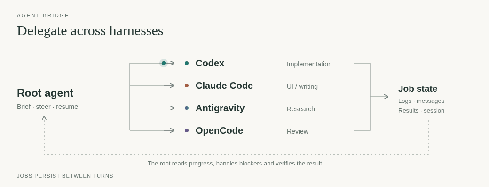

# agent-bridge

[← Packages](../README.md#packages) · **uv tool** (editable) · [Install](#install) · [When a worker needs you](#when-a-worker-needs-you) · [Restore](#restore-and-root-access) · [Reference refresh](#reference-refresh)

A cross-harness CLI that lets a root coding agent (Codex, Antigravity/agy, Claude Code or OpenCode) hand work to workers of
the other harnesses: start a job from a written brief, watch it live, steer or interrupt it, and review its result.
Keep the job for related follow-ups; retire it only when its work is resolved and its context is no longer needed.
`retire <owner>/<name>` archives the report and hides the job, keeping its data in place for
14 days by default (`--keep-days N`). `restore <owner>/<name>` makes it active again, and
`resume` continues the original thread/session. `purge` deletes expired retired jobs only
when explicitly run; `retire --purge` deletes immediately. Both keep archived reports readable
with `result`, but purged sessions cannot be restored. See `agent-bridge guide workflow`.
Jobs persist under `~/.local/state/agent-bridge`, so another root can resume or take over, and
workers can message each other with `TO <peer>:`. Plain worker messages, including ones addressed `TO root:`,
go to the coordinator as info.

`agent-bridge steer <owner>/<name> "follow-up"` delivers to a running worker, or
resumes an idle job detached in its original session. Add `--watch` to follow the
new work in the same background command. Use `--queue` to batch messages without
starting an idle job, then `resume` to deliver them in order. Retired jobs require
`restore` first. Watching alone never starts work.

`agent-bridge sessions` exports a versioned JSON inventory of native worker IDs
across all owners and backends, excluding retired jobs, for tools such as [Agent Inbox](../agent-inbox/README.md).
It contains job identity and recorded launcher metadata, never prompts, credentials
or account settings. New jobs record a parent when the root exposes its native
session ID. Other harnesses can supply `AGENT_BRIDGE_ROOT_HARNESS` and
`AGENT_BRIDGE_ROOT_SESSION` for that invocation; older jobs keep an unspecified
parent rather than guessing one. Workers cannot export other owners' inventory.



In Claude Code, [Wake](../claude/README.md#crew-and-quota-rows) draws these jobs as crew, with
worker/model/effort labels and an account quota row.

Every harness can use the same versioned object:

```sh
agent-bridge status --json                 # jobs, pressure, quota caches and peer graph
agent-bridge status --json <owner>         # owner or owner/job filter
agent-bridge status --json --storage       # also verify expired retirement and sizes
agent-bridge guide status
```

The [status guide](src/agent_bridge/guide/status.md) documents fields, polling,
unknown readings and additive V1 evolution. The checked-in
[JSON Schema](src/agent_bridge/status.schema.json) ships with the package.
Readers ignore unknown fields and reject unsupported `schema_version` values.
`owners`, `watch`, `heavy list`, quota text and Wake share the producer; peer
edges include stable IDs, direction, counts and last-activity timestamps.
Poll about every ten seconds, with storage scans on demand. Reading status never
acknowledges events. A streaming diff mode awaits a reliable cross-source cursor
protocol.

## When a worker needs you

Every watch replays unacknowledged events before following live work.
`watch --until-event` wakes for completion/failure, questions, errors and explicit
blocking/URGENT messages, with each pending job, event kind and timestamp.
Routine messages and slow/stall notices remain visible; `--include-info` also
wakes for them. Queue waits and retry status never wake the root.
Re-arming cannot discard a completion. Printing is not acknowledgement:
`agent-bridge result <owner>/<job>` acknowledges that job's completions, while
`agent-bridge ack <owner>` (or `<owner>/<job>`) acknowledges urgent events already
displayed by watch. Handle questions and errors before acknowledging them. New
events arriving after display stay pending. Use a unique owner per root; its
versioned `jobs/<owner>/ack.json` stores per-job byte cursors, with locked atomic
updates. Missing cursors replay old urgent history; old jobs need no migration.
See `agent-bridge guide workflow` for the cursor format and watch lifecycle.
Wake shows names first with compact event ages, marks 15-minute silence as
`stalled`, and keeps unacknowledged completions visible as `done`. Known turn
times appear only when useful and space allows.

Workers report questions to their root. The root asks through its native harness,
then uses [Baton](../agent-baton/README.md#unanswered-questions) for one reminder
after about three minutes if it remains active. It reads the answer and explicitly
steers or resumes the relevant Bridge job; no automatic question relay is installed.
Independent jobs can keep running while a decision is pending. Permission and
approval requirements still apply. Baton's
[workflow overview](../agent-baton/README.md#workflow-overview) diagrams this path.

## Install

Install and use (a uv tool, editable from this checkout):

```sh
uv tool install --editable ~/dotfiles/agent-bridge
agent-bridge --help            # compact command map and workflow rules
agent-bridge guide workflow    # routing, watching, briefs, review, cleanup and reference refresh
agent-bridge guide plans       # generic model strength, effort and costs (legacy command name)
agent-bridge guide subscriptions # all vendor tiers; read only for plan-dependent choices
agent-bridge start --help      # each backend's models, effort levels, quota and quirks
```

The documentation is the `guide` and per-command `--help` output on purpose, so a model reads it when it decides to rather than
carrying it in every prompt. It is assembled from `src/agent_bridge/guide/*.md`; the skill in
`agents/.agents/skills/agent-bridge/` is only a short briefing.

Notes:
- **Sandboxes are never bypassed.** Workers run in a systemd scope with memory and CPU caps; OpenCode runs
  under `bwrap`, and only the zero-retention free models are allowed.
- **A worker cannot start jobs**: it carries `AGENT_BRIDGE_WORKER`, which the CLI refuses.
- **Reference updates:** see [Reference refresh](#reference-refresh) below; the CLI help owns the review workflow.

Develop: `uv run pytest` and `uv run ruff check .` in this directory.

## Heavy commands

`agent-bridge heavy --mem SIZE -- <command>` queues heavy foreground work across all owners
and harnesses of the same host user. Workers receive this rule automatically.
Heavy means inference/benchmarks, dataset download/extraction, full suites,
long-lived servers/headless browsers, or more than about 1 GiB/several cores for
over a minute. Runners, git, edits, reads, lint, type checks and targeted tests
run directly. Waiting for a slot is normal; periodic holder status needs no ping.
Jobs run concurrently when their total declared needs fit host/slice capacity
minus the safety floor and each new need fits live free memory minus that floor,
with a 1 GiB fallback need when omitted.
FIFO permits fitting backfill for at most five minutes of head waiting.
Use `--exclusive` only for timing measurements, never for test suites;
`AGENT_BRIDGE_HEAVY_SLOTS` is an optional hard cap, unset by default.
`owners` and `watch` show pressure, declared needs, queue counts and slice OOM
kills. Existing cgroup membership and caps stay in place; slice settings are
never changed. Optional standalone caps use systemd when available and warn
before falling back. See `agent-bridge guide heavy` for defaults, research,
configuration and limits.

Root-only queue controls: `heavy list` shows request ids, jobs, needs and liveness;
`heavy cancel <id|owner/job>` cancels one unambiguous request without stopping its
worker runner. Queued commands exit **125**; running commands receive SIGTERM,
then SIGKILL after five seconds if needed. `heavy pause --reason "reviewing load"`
blocks new admissions while running work continues; `heavy resume` reopens the
queue. Pauses appear in `owners`/`watch`, persist until resumed and do not count
toward the 30-minute wait report threshold. Workers cannot use these controls.

Choose job caps with `start ... --memory 4G --cpu 400%`, or `resume <job>` with
those flags for its next launch. Caps above effective slice/host budgets are
refused. A plain resume sends `Continue.` in the same native session when no
steers are queued. Transient backend failures get four bounded, jittered retries
on the same model; exhaustion suggests resuming that same thread on another model.

## Worker environment

Worker launches remove variables whose names contain `KEY`, `TOKEN`, `SECRET`,
`PASSWORD`, `CREDENTIAL`, `AUTH` or `COOKIE` (case-insensitive). Normal runtime,
locale, proxy and backend config paths remain available; existing backend auth
files are unchanged. Set `AGENT_BRIDGE_PASS_ENV=NAME1,NAME2` in the root environment
to pass specific variables a job needs. `AGENT_BRIDGE_DENY_ENV=NAME1,NAME2` adds
exact names to remove, taking precedence over pass-through. Lists use exact,
case-sensitive names and reject wildcards or malformed entries without echoing
their contents.

The same filter covers heavy commands, account/model queries and helper
subprocesses. Set pass-through before launching a worker: a removed variable
cannot be recovered from its parent environment later. Variables such as
`SSH_AUTH_SOCK` also match the default filter and need explicit pass-through
when required. This filters inherited environments; it does not restrict auth
files or prevent a shell startup file from exporting variables again. Start a
fresh worker process to apply the policy to an already-running backend.

## Restore and root access

Install the editable uv tool as above, then run `./install.sh --apply links` from
the repository root to link its shared skill into each harness. The mapping of
skills and instructions is in [agents](../agents/README.md).

Allow the root to execute the bridge CLI outside its sandbox, read the shared
skill and read/write the jobs directory through its harness's permission controls.
Keep the resulting grants in live machine-local files, outside this public
repository. Follow `agent-bridge guide workflow` for the workflow and `agent-bridge start --help` for backend notes.
Workers carry `AGENT_BRIDGE_WORKER`, which the CLI refuses, so root
access does not grant workers permission to start more jobs. Worker sandboxing
remains in place.

## Reference refresh

`agent-bridge stale` compares live model lists with `guide/models.lock`; `start`
warns when the reference is old or a proposal is waiting. `guide/models.md`,
`guide/subscriptions.md` and their shared `models.lock` are checked by the
[reference timer](../systemd/README.md#startup-and-timers).
The check runs daily; a worker can propose an update at most weekly. Applying a proposal leaves it
uncommitted. Follow **Keeping the reference current** in `agent-bridge guide workflow`:
read the report, re-check its cited sources, then apply or discard. A root can also
read structured drift with `agent-bridge refresh --check`, edit the guides after
source review and run `agent-bridge refresh --record --yes`. Only apply/record
writes the lock; proposals, including no-change proposals, wait for review.
