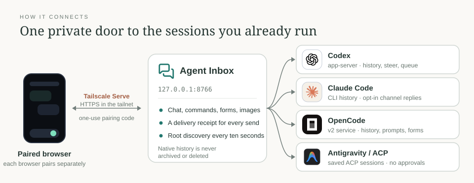
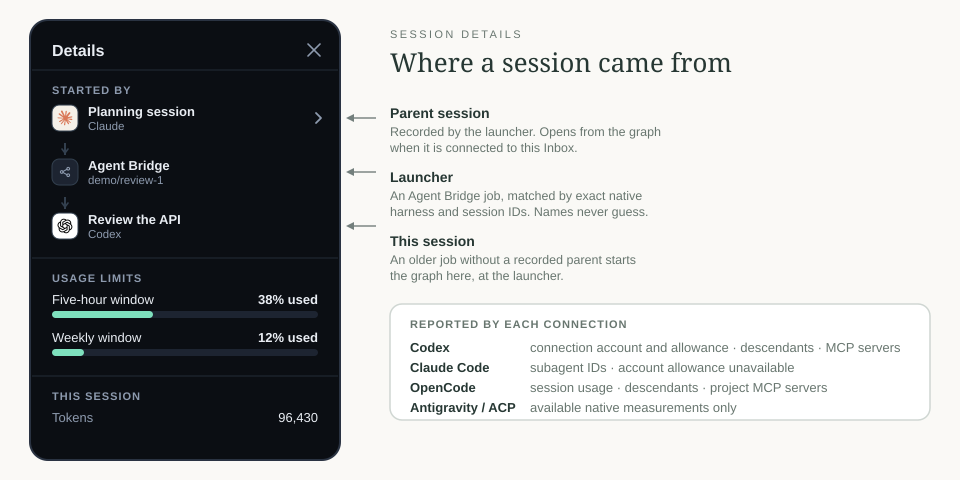
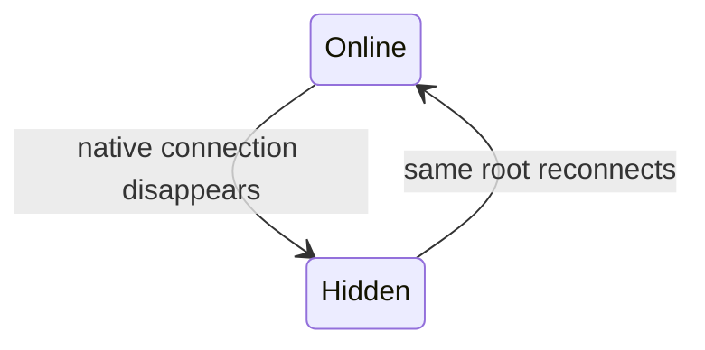

# Agent Inbox

[← Packages](../README.md#packages) · **uv tool + optional user service** · [Connect](#connect-a-harness) · [Chat](#chat-controls-and-images) · [Origin](#where-a-session-came-from) · [Phone](#connect-your-phone) · [Delivery](#lifecycle-delivery-and-privacy) · [Service](#optional-service) · [Checks](#checks)


Your existing root conversations, on your phone. Messages, images, tool activity
and pending questions share one chat stream. Model choices and `/` commands live
in the composer; the session switcher stays within reach. The header theme button
cycles System, Dark and Light, remembering the choice on that browser. Saved
conversations stay collapsed and searchable.

## Connect a harness



```sh
uv tool install --editable ./agent-inbox
agent-inbox add-codex --session "$CODEX_THREAD_ID" --label 'Current task'
agent-inbox add-opencode
agent-inbox add-claude
agent-inbox serve
```

Each connection exposes only what its native API provides; the harnesses do not
share one feature set. `/api/roots` includes a typed capability record for every
connection kind. Controls use that record plus the current native session state;
an adapter's image support still requires the selected provider to accept images.
New adapters must decide every capability explicitly, including unsupported ones.

| Connection | Read and reply | Composer controls | Session details |
| --- | --- | --- | --- |
| Codex | History, progress, queue / active-turn steering, images | Model, reasoning, rename, compact, stop | Connection account and allowance, descendants, MCP servers |
| Claude Code | Official SDK history; replies through an explicitly enabled channel | Native terminal owns model and menus | Subagent IDs; account allowance unavailable |
| OpenCode v2 | History, image input, prompt admission, forms and permission decisions | Native models, variants, agents, commands, stop | Session usage, descendants, project MCP servers |
| Antigravity / ACP | Its own saved ACP sessions, replayed chat/images, prompt updates | Native config, modes, commands, cancel | Available native measurements only |

No generic service-homepage links are added. Optional `add-native` entries open
only the exact HTTPS session URL you supply.

<details>
<summary><b>Codex</b>: existing app-server root</summary>

Registration verifies an existing root on its already-running daemon.
Its [native APIs](https://learn.chatgpt.com/docs/app-server) provide discovery,
history, `turn/steer` with the authoritative active turn ID, and the experimental
`thread/queue/add`. Messages queue by default, including during an active turn.
Choose **Steer** explicitly to steer the current turn; a finished turn rejects that
choice rather than silently queueing it. Reading never resumes or clones a conversation.
Model and reasoning changes affect subsequent turns.

When a server reports that paginated history is unsupported, Inbox uses the
read-only `thread/read(includeTurns=true)` API and pages the result locally.
Legacy history is limited to 10,000 turns/items and the connection's 16 MiB
response limit; larger histories stay native. Its cursors are bound to the root
and ordered item identities, so rewritten history requires a reload.

</details>

<details>
<summary><b>Claude Code</b>: read-only history, opt-in channel replies</summary>

Claude uses the official [read-only SDK history helpers](https://platform.claude.com/cookbook/claude-agent-sdk-05-building-a-session-browser)
and [`claude agents --json`](https://code.claude.com/docs/en/agent-view#list-sessions-as-json)
for liveness. Opt a native terminal session into Inbox replies explicitly:

```sh
agent-inbox claude
# Or close its terminal, then reopen the saved conversation:
agent-inbox claude --resume NATIVE_SESSION_UUID
```

This launches Claude's terminal with a [development channel](https://code.claude.com/docs/en/channels).
Claude presents its own consent flow. Global settings, trust and existing Remote
Control configuration stay unchanged. Channel messages wait for the next native
turn; they do not steer mid-turn. Without opt-in, discovery and history are
read-only. Each profile has separate private channels; requests verify both the
profile and native session IDs.

</details>

<details>
<summary><b>OpenCode</b>: running v2 service</summary>

OpenCode uses its already-running [v2 service API](https://dev.opencode.ai/v2/docs/api)
and currently verifies protocol version 2.0.3. Registration never starts or
reconfigures the service. Models, commands and question IDs come from the selected
session. Permission requests offer **Allow once** or **Deny**, with no default or
persistent grant. Inbox rechecks that the request is still pending in the
selected session before replying; cancelling the question denies it.
Unsupported terminal menus and external-auth forms stay native.
Its unarchived list includes saved idle roots: idle does not prove a terminal
is attached. Provider account identity and allowance are not exposed here.
Messages use native `delivery: queue` by default; explicit steering uses
`delivery: steer`. Both receipts confirm admission, not consumption.
The [published API](https://dev.opencode.ai/v2/docs/api) documents these delivery
values. Its newer permission payload uses `decision`; the checked 2.0.3 service
uses `reply`, so Inbox keeps that version's contract.

</details>

<details>
<summary><b>Antigravity / ACP</b>: any installed ACP agent</summary>

Connect an installed [ACP agent](https://agentclientprotocol.github.io/python-sdk/)
with the command option last:

```sh
agent-inbox add-acp --harness Antigravity --bridge-backend agy --command /path/to/acp-agent
```

ACP uses its own native session IDs. The checked Antigravity runtime listed no
ACP sessions and did not expose cached `agy` CLI conversations; this integration
does not clone those conversations. It never creates or authenticates a session
on registration. Its agent must advertise list, load and resume capabilities.
A selected root uses one persistent SDK connection for history updates, prompts
and cancellation. Discovery also reuses a connection; the pool permits four
runtimes total, with five-minute idle cleanup. Prompts
return a **Completed** receipt at turn completion, not an invented admission acknowledgement.
ACP has no Inbox queue or mid-turn steering; input waits until its current turn ends.
The current client declines permission/elicitation requests; approvals need its
native client. Live provider turns remain unverified here.
The reference service keeps the rest of the filesystem read-only. An ACP agent
that needs cache or workspace writes requires explicit paths in a local service
override, or a foreground run; no blanket home-directory write exception is added.

</details>

```sh
agent-inbox list
agent-inbox list --configured
agent-inbox remove ENTRY_ID
```

## Chat, controls and images

- Type `/` to search native commands, with arrows, Enter, Escape or touch.
  Native pickers are controls, not text sent to the model.
- Tool activity follows native chronology. Consecutive completed steps fold
  together; live steps stay visible. Arguments, ordinary tool output and private
  reasoning are omitted.
- Supported forms appear in chat: single/multiple choices, free text, booleans,
  numbers and conditional fields. Inputs stay scoped to their root and form.
- Inline images include user attachments and accessible native image results.
  Upload up to four PNG, JPEG, WebP or single-frame GIF images: 8 MiB total and
  25 million pixels. Animated media, audio, video and documents stay native.

<details>
<summary>Exact limits for forms, previews and media</summary>

- Codex prompts owned by another connected client are not fabricated from
  transcript text or dismissed with ordinary chat.
- Local previews read only exact paths recorded as native images. Phone text
  cannot name a host file. Arbitrary remote URLs are never downloaded.

</details>

## Where a session came from



Delegated roots carry launcher markers and a relationship graph from exact
native IDs, across Bridge owners and harnesses. A recorded parent can be opened
from the graph. Older jobs without parent metadata start at the launcher;
names are never used to guess relationships.

Details use the selected connection's measurements. Codex account data is
**connection-scoped**, not proof of the account used in earlier turns. An
account change during the read discards that quota result. Emails appear only
in the private UI. Session tokens/cost and account allowance are separate;
a reset time does not imply permission to retry.

## Connect your phone

The server listens on `127.0.0.1:8766`. Use an authenticated private network.
For Tailscale, check `tailscale serve status` and choose an unused port:

```sh
agent-inbox serve --public-url https://YOUR_NODE.YOUR_TAILNET.ts.net:8443
tailscale serve --bg --https=8443 http://127.0.0.1:8766
```

Open that HTTPS address with Tailscale connected. Run `agent-inbox pair` in your
own terminal and enter its five-minute, one-use code on the phone. Keep it out
of agent chat. **Each browser pairs separately**; the server is not bound to the
first browser. A paired device can access all registered roots.

```sh
agent-inbox devices
agent-inbox revoke DEVICE_ID
```

Codes allow eight attempts; devices expire after 30 days or immediately on revoke.
Codes travel only in the pairing POST body; the session token is an HttpOnly,
SameSite=Strict cookie (Secure on HTTPS), never a query parameter. Browser API
requests refuse redirects and use only the current origin. A failing route is
not retried against another host. OpenCode credentials likewise go only to its
validated loopback address, and its client refuses redirects.
Do not use a public tunnel. [Tailscale Serve](https://tailscale.com/docs/reference/tailscale-cli/serve)
stays inside the tailnet; Funnel is a separate feature.

<details>
<summary>One phone browser reports <code>NXDOMAIN</code></summary>

If one phone browser reports `NXDOMAIN` while another reaches the same address,
check its Secure DNS and the phone's Tailscale routing. Custom resolvers can miss
[MagicDNS](https://tailscale.com/docs/features/magicdns); that failure happens
before Inbox authentication and is not a pairing restriction.

</details>

## Lifecycle, delivery and privacy



Discovery refreshes every ten seconds without creating per-session registrations.
Native history is never archived or deleted. A selected offline root keeps its
draft and receipt and never silently redirects a reply. Codex can retain a loaded
root after its terminal disconnects. Claude lists only live processes; OpenCode
also lists unarchived saved roots. Idle is not treated as closed.
For Codex, OpenCode and ACP, transient discovery timeouts retain previously seen
roots with unknown status and a connection warning. An authoritative empty list
still removes them. Reading failures retain the visible transcript and disable input.

| Receipt | Meaning |
| --- | --- |
| Queued | Native API admitted the input; the agent may not have consumed it |
| Steered | Native API admitted input for steering; consumption is not confirmed |
| Forwarded | Claude channel write completed; no consumption acknowledgement |
| Completed | ACP returned a native prompt stop reason; its turn has ended |
| Applied | Native command or question API accepted the operation |
| Already answered | A recorded answer already claimed this native request; no new delivery |
| No longer pending | The native request was withdrawn or expired; no answer delivered |
| Unknown | Dispatch may have happened; check the native chat before sending anew |

Delivery checks reuse the same request ID and payload. Unknown outcomes are never
automatically resent, including after restart. Chat, commands and answers have
separate receipt identities. Drafts, images and retry IDs live in tab memory:
they survive root switching, but reloading discards them.

`/api/send`, `/api/command` and `/api/answer` require a client UUID (`id`). Forms
and permissions both use the answer route with their native request ID (`form`).
The receipt is persisted before dispatch: **Sending** means intent recorded,
not native acceptance. Retries return its recorded outcome without redispatch.
Answer receipts also claim the root/request pair transactionally, so another
browser's new UUID cannot answer or cancel the same request twice. Concurrent
receipt checks follow the original answer's eventual result, including Unknown.
Pre-upgrade answers acquire this request claim on an exact replay; their old
content hashes cannot reveal native request IDs without that replay.

OpenCode owns pending forms/permissions across Inbox restarts: Inbox re-reads its
native pending list before answering and rechecks a raced withdrawal after a
native conflict. There is no cached pending flag to hang after restart.
The capability `approvals_survive_restart` refers to an **Inbox** restart; it does
not promise a provider survives its own restart. Codex questions/approvals stay
with their owning client, ACP requests are declined immediately, and Claude's
native behavior is unchanged. In-flight receipts recover as Unknown, never as
fresh work. Choices always carry native values; labels need not be unique.

State: `${XDG_STATE_HOME:-~/.local/state}/agent-inbox`, configurable with `--state`
or `AGENT_INBOX_HOME`. Directory mode 0700, database mode 0600. Credentials are
hashed; receipts store content hashes, not text. HTTP bodies, URLs and native
diagnostic contents are not logged. Approvals and secrets remain native or use
[Baton](../agent-baton/README.md).

<details>
<summary>Buffers and size bounds</summary>

Uploads create no directory. Preview bytes use a bounded, authenticated 32 MiB
memory cache. Claude channels retain unseen attachments until read and reject
new input when full. SDK history reads are bounded to 16 MiB of native transcript.
Unavailable or oversized content stays native.
Channel buffers are in memory: restarting Claude loses attachments it has not
read yet; images already returned by its image tool remain in native history.

</details>

## Optional service

Link `agent-inbox.service` into `~/.config/systemd/user/`. Put the machine's origin
in `~/.config/agent-inbox/environment`:

```ini
AGENT_INBOX_PUBLIC_URL=https://YOUR_NODE.YOUR_TAILNET.ts.net:8443
```

Run `systemctl --user daemon-reload` and
`systemctl --user enable --now agent-inbox.service`. WSL must remain running.
Disable with `systemctl --user disable --now agent-inbox.service`; remove only
its Tailscale forward with `tailscale serve --https=8443 off`.
The reference unit pins state to `~/.local/state/agent-inbox`; changing that path
also requires updating `--state`, `StateDirectory` and `ReadWritePaths` together.

## Checks

```sh
uv sync --locked
uv run pytest -q
uv run ruff check src tests
node tests/test_ui.mjs
```

Fixtures cover pairing, origins, root/profile isolation, replay/unknown outcomes,
native controls, conditional forms, image limits, catch-up and session-switch
races. Visual changes also need rendered phone and desktop checks. Tests never
start model turns in real conversations. Vendor marks keep their owners' terms
([notice](src/agent_inbox/assets/NOTICE.md)).
