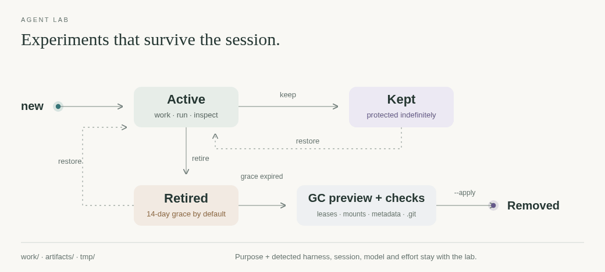

# agent-lab

[← Packages](../README.md#packages) · **uv tool + live skill and timer** · Linux / WSL

Persistent experiments for any harness or language. Ordinary files stay outside
projects and survive terminal restarts; creator and latest-run provenance stay
with them. Project changes still belong in their repository or a Git worktree.



## Use

```sh
uv tool install --editable ./agent-lab
lab=$(agent-lab new image-probe --purpose 'Compare image decoders')
agent-lab path "$lab"                       # work/ for native file/edit tools
agent-lab run "$lab" -- node --version      # any executable; exact argv, no implicit shell
agent-lab show "$lab"                       # provenance, paths, sizes and warnings
agent-lab retire "$lab" --summary 'Useful finding moved to the project docs'
agent-lab gc                               # preview; retirement grace defaults to 14 days
```

`keep ID` protects indefinitely. `restore ID` clears keep/retirement and reuses
the same paths. Repeating `retire` preserves the existing deadline. `list --sizes`
scans usage across labs; `new --json`, `list --json` and `show` support automation.
`run ID [provenance flags] -- COMMAND ...` preserves input/output and exit status.

## Files and provenance

```text
${XDG_STATE_HOME:-~/.local/state}/agent-lab/   private, local, outside Git
├── records/<id>.json                       purpose, creator, latest run, retirement
├── locks/                                  command leases and registry lock
└── workspaces/<id>/
    ├── work/                               command working directory
    ├── artifacts/                          outputs and evidence
    └── tmp/                                scratch that survives restarts
```

`run` exposes `AGENT_LAB_ID`, `AGENT_LAB_WORKSPACE`, `AGENT_LAB_ARTIFACTS` and
`AGENT_LAB_TMP`; its child gets `TMPDIR=tmp/`. This changes no global environment.
It also carries `AGENT_LAB_HOME`, an absolute registry override, so nested tools
keep the same lab when a harness changes `HOME` or its XDG profile. Independent
workers can receive that override when intentionally sharing labs; native sandbox
permissions still apply. `show`, `list` and `path` need read access only.
Bridge carries the host registry into its isolated worker profiles automatically.
Files are ordinary local files, not a sandbox, secret store or backup.

Provenance includes the originating directory and available Git root/branch/commit,
harness, session, model and effort. Creator and latest runner remain separate.
Detection uses the calling Codex thread's native state, Claude's exact session
and latest assistant model, Antigravity's exported conversation ID, or Bridge's
own worker record across all four harnesses.
It never picks a nearby session or a global default. Explicit `--harness`,
`--session`, `--model`, `--effort` or corresponding `AGENT_LAB_*` variables are
optional overrides/fallbacks. Unexposed values stay null; native schema changes
do not block experiments. No account credentials,
environment dumps, command arguments or output transcripts are recorded.

After a run, and in size reports, soft warnings flag a lab at **1 GiB** or a file
at **256 MiB**. Counts are logical file sizes, exclude symlink targets and can
count hard links twice. They are warnings, not disk quotas or automatic deletion.

## Retirement and cleanup

Only registered, explicitly retired labs past their grace period qualify.
Active/kept labs, command leases, invalid metadata, redirected roots, mounts and
folders containing `.git` prevent cleanup. Git checkouts/worktrees need their
native cleanup first. Unknown folders are left alone; inspection failures never
grant permission to delete. File symlinks are removed without following targets.

Use `run` for commands that need a cleanup lease; native edits do not hold one.
Keep a lab if independent processes or manual work still need it. A wrapper
crash leaves a live direct child's inherited lease in place; an interrupted run
record with no lease indicates an unfinished receipt, not proof of a live process.
Retirement is recoverable with `restore` until GC; applied deletion is permanent.
Promote durable findings to maintained project docs before retiring experiments.

The [weekly user timer](../systemd/README.md) runs `gc --apply` through these same
checks. It never retires active labs or changes native harness histories. Install
with `./install.sh --apply links systemd`; disable with
`systemctl --user disable --now agent-lab-gc.timer`. WSL must be running for timers.

## Checks

```sh
uv run ruff format --check src tests
uv run ruff check src tests
uv run ty check src
uv run pytest
```
