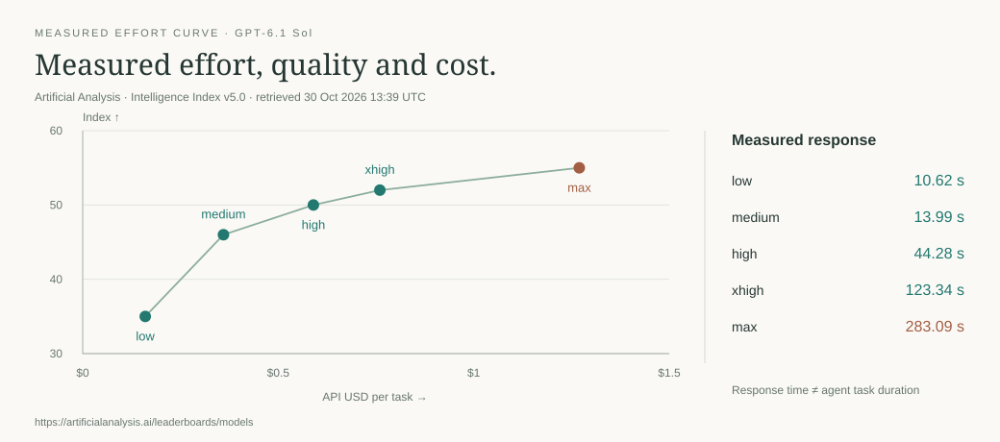

# agent-models

[← Packages](../README.md#packages) · **uv tool** · shared model references


Model strengths, effort and published allowances have one owner, independent of
worker orchestration. The model-selection skill reads this reference on demand.
The reference compares domain evidence and cost-performance frontiers alongside
the overall score: Arena, Artificial Analysis, LiveBench and Vals measure different
parts of a model's strengths. Sources and benchmark versions are recorded explicitly.



[Dated measurements and methodology](src/agent_models/guide/models.md#effort-and-model-strength).

```sh
uv tool install --with-editable ./agent-accounts --editable ./agent-models
model-guide read models
model-guide models --backend codex --json  # native IDs/efforts + generated coverage
model-guide read subscriptions     # only for allowance/retention decisions
model-guide check                  # reference files only; no provider processes
model-guide check --live           # explicitly query native inventories
model-guide refresh --prepare      # public data + cost curves; no model worker
model-guide benchmarks --backend claude --domain design --query sonnet --limit 5 --brief
model-guide benchmarks --backend codex --domain backend --limit 3 --brief
model-guide read maintenance
```

The daily `agent-models-reference.timer` checks drift; at most weekly it asks
an installed Bridge to run a sandboxed proposal worker. Bridge is an optional
execution route for proposals, not an import dependency. Reading, checking,
source review and recording direct edits work without it. No update applies
automatically. State belongs to `$AGENT_MODELS_HOME` or
`${XDG_STATE_HOME:-~/.local/state}/agent-models`; documents and review hashes live
in `src/agent_models/guide/`. Reference edits remain uncommitted.

Benchmark search returns bounded source evidence: release/retrieval dates, domain
scores, effort, available cost/time and automatically read local account hints.
Missing measurements stay unknown. The full local snapshot supports rechecks
without loading an entire leaderboard into the agent's context.

Queries show **quality leaders** and **cost-efficient choices** as separate bounded
views, so a small limit does not hide cheap workers. Frontiers are recalculated
after native/query filtering, within the same source, release and metric; table
runs with different harnesses stay separate. API cost is not subscription quota.
`--domain backend` uses coding and terminal evidence and names the gaps in database,
security and service-architecture coverage. Writing retains its text-preference
scope. `--brief` keeps source dates, confidence intervals, run settings and account
freshness in compact text; omit it for JSON and the complete returned fields.

`--backend` matches exact model identities from Codex, Claude, Antigravity or
OpenCode; `--query` narrows by native ID/alias. Claude aliases resolve through
initialization with no prompt, session history, hooks or MCP launches. Codex and
Claude publish per-model effort metadata; OpenCode's native API CLI supplies
enabled models and variants for the current directory. agy's text listing leaves
efforts unknown: verify its selected native controls. `--account` scopes cached
account observations; only agy supports an explicit native inventory account.
Otherwise the listing uses the current native profile. No account is switched.
Native responses are captured through a temporary regular-file handle: OpenCode
can truncate large JSON when it exits while pipe output is still pending. The
file closes after each read; catalogs and account observations are not tracked.

For a coding worker, query `--backend codex --domain coding --query gpt-6.1-sol`,
compare its measured effort curve, then use a model/effort exposed by the actual
native subagent tool. For visual work, query `--backend claude --domain design`;
use Bridge only when delegating across harnesses. Measurements narrow the choice;
the agent still judges task fit, allowance and verification needs.

Listings describe native CLI inventory, not entitlement or the models selectable
by a particular native subagent tool. Account caches are separate observations;
the current session's native controls remain authoritative. The reviewed OpenCode
privacy allowlist lives in inventory.py and is also consumed by Bridge.

This separation follows the useful distinction in
[T3 Code's provider constraints](https://github.com/pingdotgg/t3code/blob/main/docs/internals/providers.md):
shared orchestration does not own provider protocols or account lifecycle.
We reuse that boundary; no T3 runtime or additional provider server is installed.

Checks: `uv run pytest` and `uv run ruff check src tests`.
