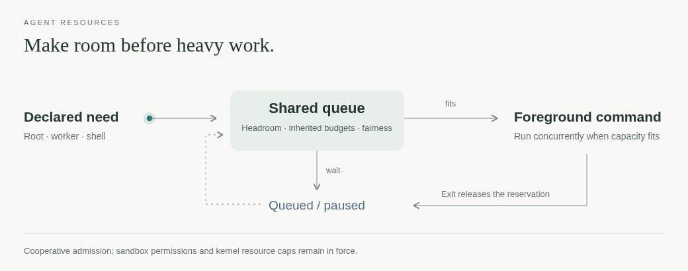

# agent-resources

[← Packages](../README.md#packages) · **uv tool** · host resource admission



Cooperative admission for memory-heavy or sustained multi-core commands. Kernel
locks hold reservations across exec and release them on process exit. This is
resource coordination, not a sandbox.

```sh
uv tool install --editable ./agent-resources
agent-resources run --mem 2G -- uv run pytest
agent-resources run --mem 3G --exclusive -- ./benchmark
agent-resources list
agent-resources guide
```

Arguments, environment, stdin, signals and exit status pass through. Bridge
filters its worker environment before launch; this runner does not strip secrets
from an ordinary command. Jobs can run concurrently when their declared needs
fit. Reserve exclusivity for measurements, not test suites. Keep commands in the
foreground; detached descendants are outside the lease's guarantee.

The private queue is `/tmp/agent-resources-<uid>` or `$AGENT_RESOURCES_HOME`,
independent of HOME/TMPDIR. All participants on a host use the same queue path.
`AGENT_RESOURCES_SLICE` names an optional shared systemd budget (default agent.slice);
Bridge supplies its existing codex.slice integration explicitly. Worker environments
carry a controller identity and cannot mutate the queue. Cancellation of a known
controller's request requires that exact root identity. This protects against
accidental session crossover, not an untrusted process with the same OS account.

An explicit memory cap must be enforceable; an unavailable systemd scope is an
error. Existing inherited caps are preserved. Inspect actual limits and use
real-workload peak measurements when choosing a memory estimate.

Checks: `uv run pytest` and `uv run ruff check src tests`. See `agent-resources guide`
for admission policy, inherited limits, cancellation and its sources.
