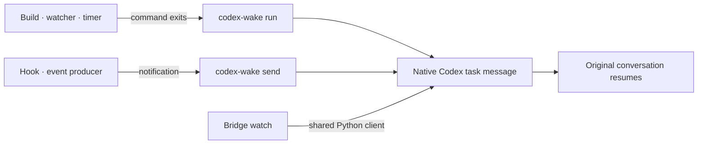

# Codex task notifications

[← Packages](../README.md#packages) · **uv tool** (editable) · Codex-specific

Wake an existing Codex conversation when something needs its attention. Builds,
file watchers, timers and other tools can send native task notifications after
the model goes idle. The command is `codex-wake`; Claude's visual
[Wake mod](../claude/README.md#wake-mod-live) is a separate feature.
No Bridge installation is required.



## Use

```sh
uv tool install --editable ~/dotfiles/codex-wake
codex-wake check
codex-wake send --message "The preview is ready for review."
codex-wake run --message "Build finished; inspect its terminal output." -- make build
codex-wake run --message "Recheck the pending deployment." -- sleep 180
```

Run `run` in the harness's background terminal and continue independent work.
It stays attached to its command, then sends one notification on success or
failure. A one-shot watcher works the same way: use its “exit on event” option.
Continuous event producers call `send` for each event they choose to surface.
The harness's usual background-process lifetime still applies; this tool is not
a service manager and cannot survive its own process being killed.

The target defaults to `CODEX_THREAD_ID` and `CODEX_HOME` (otherwise `~/.codex`).
Use `--thread THREAD --home /path/to/codex-home` on any subcommand when the producer
runs outside that session. Capture the intended target before starting a job;
never substitute whichever conversation happens to be active later.

| Command | Behavior |
| --- | --- |
| `check` | Verify the socket and native tool without waking a conversation. |
| `send --message TEXT` | Deliver one automatic task notification. |
| `run --message TEXT -- PROGRAM ARG…` | Preflight, run the exact argument list, then notify with its exit status. |

`run` inherits stdin/stdout/stderr and preserves the command's exit status
(signals use `128 + signal`). No shell is inserted; use an explicit shell if
your command needs shell syntax. An unavailable program returns 127 after
notification; setup or delivery failure returns 125 with an error on stderr.
Delivery failure can happen after the command ran: inspect its output before
retrying. Messages must fit **1,000 UTF-8 bytes**, including the CLI's automatic
notification label and command status; oversized messages fail before execution.
Command output is not copied into the notification. Keep credentials out of messages.

## Agent workflow

Use the harness's native completion trigger when it already resumes the session.
Otherwise start `codex-wake run --message "What finished and what to do next" -- COMMAND`
in a persistent background terminal, retain its handle, and continue independent work.
When only the event remains pending, end the model turn; the notification resumes
the same conversation. Read the original terminal for command output after waking.
Use `send` from an existing event producer. Bridge watch already uses this client;
wrapping it again would produce duplicate notifications. A timer inside a yielded
model-runtime code cell is not a persistent terminal process.

The [Codex-only skill](../codex/.codex/skills/codex-wake/SKILL.md) is live-linked
under `~/.codex/skills/codex-wake` by `./install.sh --apply links`. Codex can select
it on demand, or it can be invoked as `$codex-wake`. The shared global instructions
stay harness-neutral. The CLI includes examples and defaults to its originating
session without manual thread IDs or setup flags.

## Shared delivery client

```python
from codex_wake.client import Wake

target = Wake(thread_id, home=codex_home)
target.check()  # before consuming an event or starting expensive work
target.send("Automatic build notification: inspect the result. Not user approval.")
```

The target is fixed at construction. Each check/send opens and closes its own
connection. Callers own event detection, batching, cancellation, acknowledgement
and whether a notification warrants more work. Bridge keeps those policies in
its [watch adapter](../agent-bridge/src/agent_bridge/root_wake.py).

## Compatibility and failures

The transport uses the running Codex home's Unix control socket and discovers
`codex_tui.send_message_to_thread` for the requested conversation. This is the
existing harness capability Bridge used; the socket and native tool are **local
integration details**, not a promised cross-version OpenAI wake API. The
[official app-server protocol](https://learn.chatgpt.com/docs/app-server) documents
initialization, paginated MCP discovery and tool calls. The client checks the
returned thread receipt, bounds each RPC wait to 15 seconds and rejects malformed
responses. It does not start another app server or silently switch delivery routes.

Acceptance confirms submission to the target, not completion of its next turn.
A busy session receives the native follow-up behavior of its harness. A lost
receipt leaves delivery uncertain; no automatic retry risks a duplicate.
Notifications never grant approval or authorize new work.

Claude Code's [async hook wake](https://code.claude.com/docs/en/hooks#run-hooks-in-the-background)
is a useful counterpart: event completion can resume an idle agent. This tool
provides that usage pattern for Codex through its available native task channel;
other harnesses keep their own supported mechanisms.

## Checks

From this directory: `uv run --locked pytest` and
`uv run --locked ruff check src tests`.
For live compatibility, run `codex-wake check` inside the target session. To verify
idle resumption, arm a short `run -- sleep …` notification with a recognizable
marker, finish the model turn, and confirm the same session resumes on that marker.
