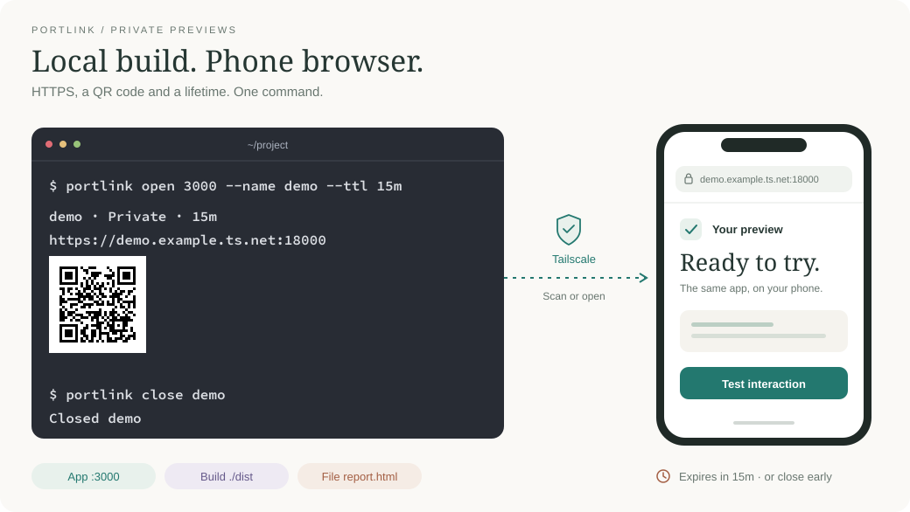

# portlink

[← Packages](../README.md#packages) · **uv tool** (editable) · [Share](#share-a-preview) · [Install](#install) · [Access](#access-and-troubleshooting) · [Lifetime](#lifetime-and-ownership) · [Checks](#checks)

Private, expiring HTTPS links to a local app, build folder or file. Open the link
on your phone over Tailscale; close it when finished, or let it expire.



## Share a preview

```sh
portlink open 3000 --name demo
portlink open ./dist --name docs --ttl 15m
portlink open ./report.html --name report
```

```sh
portlink list
portlink qr demo
portlink close demo
```

`open` returns the private HTTPS URL and saves a QR image. An interactive terminal
also displays the QR. `portlink qr demo` shows it again. Add `--json` to any command
for structured output without terminal QR art.

The terminal inset uses **SauceCodePro NFP SemiBold, 12 pt**, matching the
[terminal configuration](../windows/README.md). Regenerate it with
[`docs/tools/portlink_preview.py`](../docs/tools/portlink_preview.py).

| Control | Behavior |
| --- | --- |
| Lifetime | One hour by default; `--ttl 30s`, `15m`, `2h` or `1d` |
| `--keep` | No expiry; stops when closed or the host/user service manager shuts down |
| `--listen 18443` | Fixed HTTPS port; refuses existing routes |
| Automatic ports | First unused port from 18000 upwards, counting background and foreground routes |
| Files | Serves only the selected file; siblings remain unavailable |
| Directories | Serves assets and `index.html`; blocks dotfiles, directory listings and symlink escapes |
| State | Private records and QR files under `${XDG_STATE_HOME:-$HOME/.local/state}/portlink/` |

## Install

Linux/WSL with a working `systemd --user` manager, a current Tailscale CLI and `uv`:

```sh
uv tool install --editable ~/dotfiles/portlink
portlink doctor
```

The repository installer includes it in `./install.sh --apply uvtools`.
Sign in to Tailscale first. Serve configuration requires the node's existing
Tailscale operator permission. This tool never changes that permission, tailnet
policy or public Funnel settings.

## Access and troubleshooting

Start the app normally, then share its HTTP port. `http://localhost:3000` is also
accepted; remote targets, URL credentials and path-prefix proxies are rejected.
Keep the app listening on the intended host's loopback interface. A Windows app
must be reachable from WSL's loopback before this WSL CLI can share it.

Open the returned URL with Tailscale connected on the phone. Access follows your
tailnet's rules. Host/WSL, Tailscale and the app must remain running. Previews
created with `--keep` are not boot-persistent deployments.

```sh
portlink doctor demo
```

The checks distinguish the local app, host DNS, HTTPS and user service manager.
An app may need the exact preview hostname/origin allowed in its configuration;
the tool does not disable app protections. A host DNS failure is not proof that
the phone's DNS also fails: check Tailscale/MagicDNS and any custom Secure DNS
on the affected device. HTTPS certificate verification stays enabled.

## Lifetime and ownership

Each preview is a unique transient user service containing its own foreground
Tailscale Serve process. `RuntimeMaxSec` expires it independently of the opening
agent or terminal. Tailscale removes that foreground session's routes when the
process exits. Closing verifies the registered unit's identity before stopping it;
there is no global `serve reset` or port-wide `off` operation.

Static previews use a loopback-only Python server in the same service because
Tailscale's native filesystem mode can require root access. Stopping the service
also stops that server. Application servers supplied by the user are left running.

Expired route processes and transient units disappear automatically. The next
`open` or `list` removes their records and QR files, including abandoned startup
writes. State and device URLs stay outside Git.

## Checks

Run from this directory; UV locks both runtime and development dependencies:

```sh
uv run --frozen pytest -q
uv run --frozen ruff check .
```

Sources: [Tailscale Serve](https://tailscale.com/docs/reference/tailscale-cli/serve),
[foreground lifetime](https://tailscale.com/docs/reference/examples/serve),
[systemd-run](https://www.freedesktop.org/software/systemd/man/systemd-run.html),
[Segno QR API](https://segno.readthedocs.io/en/stable/api.html).
