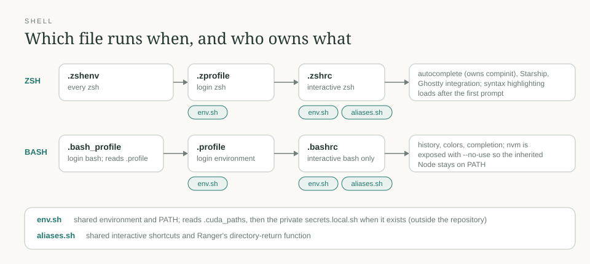

# shell

[← Packages](../README.md#packages) · **Live** · `./install.sh --apply links` links the startup files listed in the installer into `$HOME`

Bash and Zsh startup.

| File | Owns |
| --- | --- |
| `.zshenv`, `.zprofile`, `.zshrc` | Zsh startup, in Zsh's native order; `.zshrc` is the interactive part |
| `.bash_profile`, `.profile`, `.bashrc`, `.bash_logout` | Bash startup; `.bash_profile` reads `.profile` |
| `.config/shell/env.sh` | Shared environment and PATH for both shells; sources the private `~/.config/shell/secrets.local.sh` when it exists |
| `.config/shell/aliases.sh` | Shared interactive shortcuts and Ranger's directory-return function |
| `.local/libexec/agent-process-guard.py` | Shared shell-process correctness hook |
| `.cuda_paths` | CUDA paths, sourced by the environment file |



## Shortcuts

Shared shortcuts preserve arguments: `ga path...` stages explicit paths, and
`py` runs Python through UV. `pir` is only for requirements-based projects with
an existing UV environment; projects with a lock use `uv sync` instead. Package
managers own their caches; no generic cache-deletion shortcut is installed.

## Agent process matching

`agent-process-guard.py` is linked under `~/.local/libexec`. Native hooks invoke
it automatically before command execution:

| Harness | Integration | Setup |
| --- | --- | --- |
| Claude | Bash `PreToolUse` | `./install.sh --apply links hooks` |
| Codex | Bash `PreToolUse` | Same; trust new hooks through `/hooks` |
| Antigravity | `run_command` `PreToolUse` | Same; named hooks in `~/.gemini/config/hooks.json` |
| OpenCode 2.2.2+ | `execute.before` plugin for `shell` | `./install.sh --apply links`; global plugin discovery |

Reload the harness after setup; Antigravity's `/hooks` lists loaded hooks. Agents
do not invoke the helper themselves. It rejects actual `pgrep`/`pkill` full-command matches
unless they exclude ancestors (`-A` / `--ignore-ancestors`). The guard never
executes or rewrites submitted commands, approves requests or signals processes;
the agent gets a correction before the tool call. Exact-name queries and explicit
PID operations stay available.

```sh
pgrep -x worker                 # exact executable name
pgrep -A -f 'python worker.py'   # full command, excluding the invoking ancestry
kill -TERM "$owned_pid"         # verify the PID belongs to the intended task first
```

The guard uses the installed `shfmt` parser, not regex matching over shell text.
Chains, loops, substitutions and common static wrappers are inspected. Quoted
examples and log searches remain data. Dynamic commands and externally read scripts
are outside this mistake guard; it is not a sandbox or authorization boundary.
Unsupported syntax, a missing parser or a parser error blocks candidate commands
with a PID-based alternative, while unrelated commands are unaffected.

Ancestor exclusion depends on the procps version: check `pgrep --version` and
`pgrep --help` before using it. Where unavailable, use exact names or owned PIDs.
Tests: `python3 -B tests/test_process_guard.py`; parser fixtures never execute the
commands, and a modern-procps smoke test signals only its own disposable child.
`bun test tests/test_process_guard_plugin.test.js` exercises OpenCode's adapter
with the same helper. Hook decisions follow each harness's native denial contract;
Antigravity's `allow` only defers to its normal permission policy.

Contracts: [Antigravity hooks](https://antigravity.google/docs/hooks),
[OpenCode server plugins](https://opencode.ai/v2/docs/build/plugins/server/) and
[plugin discovery](https://opencode.ai/v2/docs/plugins#discover).

## Credentials

Put credentials in `~/.config/shell/secrets.local.sh`, outside the repository:
mode `0600` for the file, `0700` for its directory. Both shells source it through
`env.sh`; it is an ordinary shell file, with no separate dotenv parser. Provision
it separately through encrypted transfer or a password manager. It is excluded
from Git, not encrypted. See [chezmoi's guidance](https://www.chezmoi.io/user-guide/setup/)
for the general dotfile-management approach.

Original startup-file backups stay outside Git under
`${XDG_STATE_HOME:-$HOME/.local/state}/backups/shell/`, with owner-only permissions.

## Startup behavior

`shell/.config/shell/env.sh` owns shared environment/PATH setup and the private
credential include. `aliases.sh` owns shared interactive shortcuts and Ranger's
directory-return function. `.bashrc` and `.zshrc` own only their shell's
interactive behavior. Login setup follows the shells' native startup order:
`.bash_profile` reads `.profile`, while Zsh reads `.zprofile`.

Inherited Windows/WSL and virtual-environment paths remain in PATH. Local paths
are added once; startup does not change directory or print greetings. The
installed autocomplete plugin owns Zsh's `compinit`; `.zshenv` prevents Ubuntu's
global duplicate initialization. Syntax highlighting loads after the first
prompt's deferred autocomplete widget setup through a one-shot Zsh `precmd`
hook. This follows the requirement to load highlighting after widget creation
without placeholder widgets or changes to either installed plugin. See the
[highlighting instructions](https://github.com/zsh-users/zsh-syntax-highlighting/blob/master/INSTALL.md)
and [Zsh's public hook API](https://zsh.sourceforge.io/Doc/Release/User-Contributions.html#Manipulating-Hook-Functions).

## Node and NVM

Bash exposes NVM with its documented `--no-use` option, preserving the inherited
Node executable: `~/.local/bin/{node,npm,npx}` are machine-local links to an
NVM install, so tool installers can't silently replace the
Node on PATH. Node uses Ubuntu's updated CA store through `--use-openssl-ca`
until installed runtimes include the emergency CA blocklist; restart existing
Node processes to apply it. The existing npm global prefix is retained. NVM's manual
version switching is incompatible with that prefix; resolve the prefix before
using `nvm use`, as described in [NVM's documentation](https://github.com/nvm-sh/nvm).

## Dependencies and checks

Needs Zsh autocomplete and syntax highlighting under `~/.local/share/zsh/plugins/`,
Starship, Ranger and `rtk` on PATH. Install each tool's OCI/Bun/Grok completions
through that tool. Check syntax without sourcing credentials:

```sh
zsh -n shell/.zshrc
bash -n shell/.bashrc
```

From the repository root, `python3 -B tests/test_shell_startup.py` checks quiet
startup, inherited paths, the working directory and tool resolution.

## Tool data locations

Shared shell environment sets Go's workspace to `~/.local/share/go` and module
cache to `~/.cache/go/mod`, using its supported `GOPATH` and `GOMODCACHE` options.
The compiler installation remains separate. Gensim downloads use `~/.cache/gensim`
through `GENSIM_DATA_DIR`; NLTK datasets use `~/.local/share/nltk_data` through
`NLTK_DATA`. These data/dependency directories are outside dotfiles. Retired NLP
datasets are not included here; old coursework may require downloading them again.

Zsh plugin checkouts are application data, separate from the startup configuration
tracked here. Keep their existing versions during a directory migration and update
both `.zshrc` and `.zshenv` references together. See the
[XDG directory specification](https://specifications.freedesktop.org/basedir/latest/),
[Go module-cache documentation](https://go.dev/ref/mod#module-cache),
[Gensim downloader](https://radimrehurek.com/gensim/downloader.html), and
[NLTK data documentation](https://www.nltk.org/data).

Snap's `~/snap` and Oracle CLI's `~/lib/oracle-cli` and `~/bin` are their managed
installation defaults. Keep those paths unless migrating through the owning tool.
Use npm, Bun and uv's cache-cleaning commands for their caches; cache cleanup can
require downloads later. Job artifacts and saved sessions need a separate retention
decision rather than deletion based only on directory name or size.
